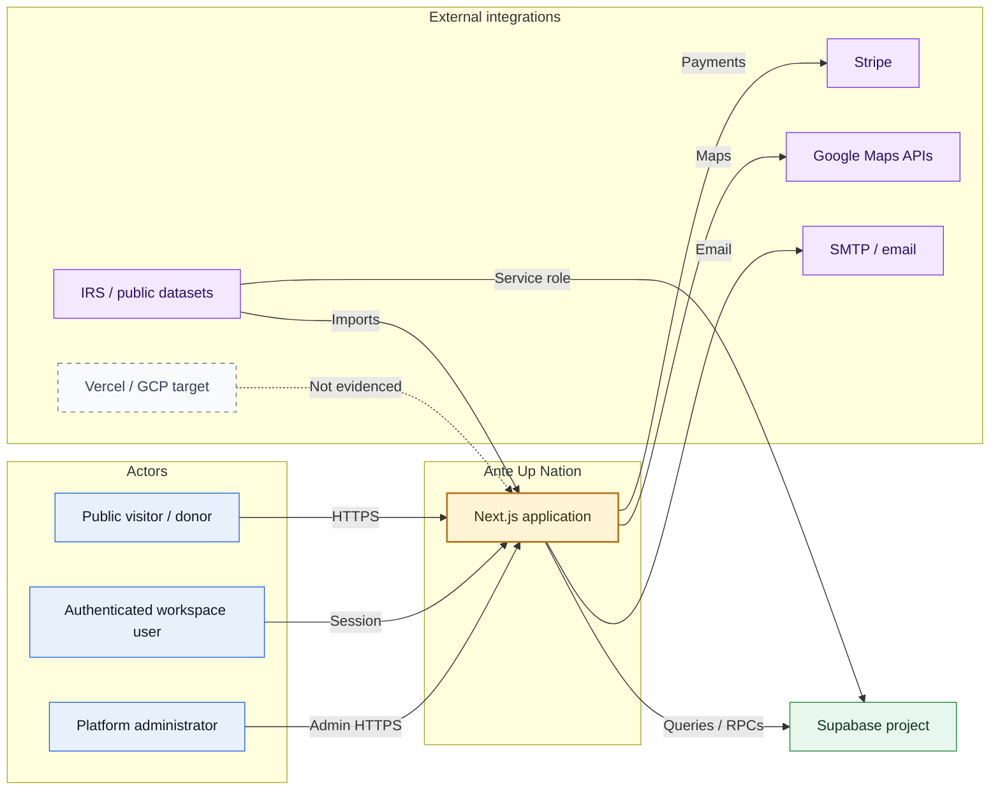
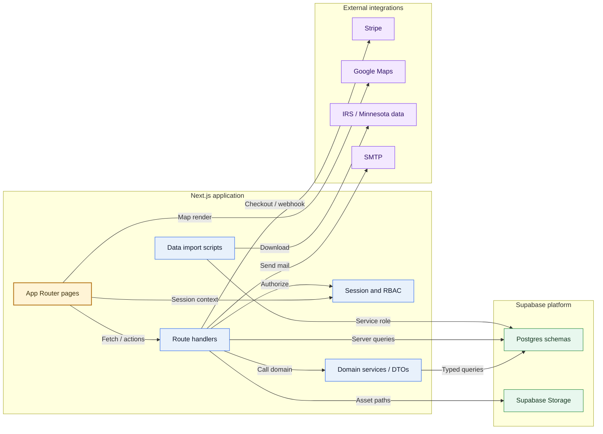

# 01 — System Context and Container Architecture

## Scope and evidence

This document describes the architecture evidenced by the current source tree, current Supabase migrations, `database.types.ts`, and the Next.js App Router. Archived migrations are treated as history, not as current runtime behavior. The repository identifies the product as pre-production in `README.md`.

Key evidence: `package.json`, `middleware.ts`, `utils/supabase/*`, `app/api/**`, `supabase/config.toml`, `supabase/migrations/**`, and the import scripts under `scripts/`.

## System context view

### Context interpretation

- Public and authenticated users enter through the same Next.js application. `middleware.ts` refreshes Supabase sessions and applies route-level admin/entity-admin redirects.
- Supabase is the system of record for the database, Auth, exposed schemas, RPCs, RLS and local Storage configuration. The app uses both the user-scoped server client and a service-role client in selected server/import paths.
- Stripe is a real integration: checkout routes create sessions and `/api/stripe/webhook` verifies signatures and upserts `donations`/`subscriptions`.
- Google Maps is a real client integration through `@react-google-maps/api`; Google geocoding is used by `scripts/geocode-nonprofit-addresses.ts`.
- IRS and Minnesota public-data ingestion are implemented as scripts, not as an in-request ETL service.
- No GCP SDK, Cloud Run/Functions manifest, Cloud Build file, Terraform/Pulumi module, `vercel.json`, or `.github/workflows/**` file was found. Vercel/GCP deployment is therefore an operational assumption or external configuration, not a repository-proven container.

## Container view

## Technology stack decision matrix

| Layer | Repository evidence | Why this choice fits the implemented system | Scalability / cost boundary visible in code |
|---|---|---|---|
| Web runtime | Next.js 16, React 19, App Router, server/client components | One codebase supports public pages, authenticated workspaces and API route handlers | Server work is request-bound; large imports are kept out of request paths and run as scripts |
| Language and contract | TypeScript 5.8, generated `database.types.ts`, domain DTOs | Strong compile-time contracts across route handlers, Supabase queries and UI | Generated types must be regenerated after migrations; stale types are a release risk |
| Styling/UI | Tailwind CSS, Radix slot, AG Grid, Framer Motion | Reusable responsive UI, data-heavy admin tables and interactive map/workspace components | Browser bundle and grid/map payload sizes are practical limits; map data is chunked and cached |
| Data platform | Supabase Postgres 15, exposed schemas, RLS, RPCs | Relational integrity, tenant-aware policies, typed Data API access, database-side lifecycle rules | `supabase.config.toml` caps Data API responses at 1,000 rows; query/index design matters as data grows |
| Geospatial | PostGIS extension, GeoJSON, Turf/D3 geo, Google Maps | Stores geometry in Postgres while rendering/drilling into map features in the browser | Geometry payload size is a bottleneck; `/api/map/home` chunks IDs and uses simplified boundaries plus HTTP caching |
| Authentication | Supabase Auth + `@supabase/ssr` cookies | Session refresh works across middleware, server components and route handlers | Token/session settings are in Supabase config; MFA is present only as disabled local configuration |
| File storage | Supabase Storage references and bucket/path columns | Assets and IRS documents use stable bucket/path metadata | Local config sets a 50 MiB file limit; remote bucket policy is outside this repository |
| Payments | Stripe SDK and client checkout | Stripe owns payment collection; webhook is the source of payment reconciliation events | Webhook idempotency relies on `stripe_session_id`/invoice upserts; retries and provider latency remain external |
| Public-data ingestion | `tsx` scripts, local caches under `data/`, service-role Supabase client | Handles large IRS XML/ZIP files and public datasets without blocking web requests | Disk/cache retention, IRS availability, parse variation and service-role blast radius are operational boundaries |
| Email | Nodemailer | Supports invite, invoice and contact delivery without coupling domain code to one vendor | Delivery depends on SMTP configuration; local Supabase email is captured by Inbucket |
| AI governance primitives | AI account, credit ledger, usage events, agent runs and safety policy JSONB | Establishes budget, usage and audit records for entity-scoped AI capabilities | Current repository proves accounting/control tables and governance RPCs; it does not prove a specific external model provider |
| Delivery infrastructure | `package.json` scripts and local Supabase config | Reproducible local development and migration reset workflows | No committed Vercel/GCP manifest or CI workflow; promotion, secrets and rollback are not codified here |

## Architecture boundaries and risks

1. The service-role client is intentionally used for Stripe webhooks, map home aggregation and import scripts. Those paths must remain server-only and must not accept arbitrary tenant writes without explicit validation.
2. Several public-facing views use `Cache-Control`, `revalidate`, or `no-store`; this is deliberate but not centrally standardized.
3. The repository has local Supabase configuration, but hosted Supabase, Vercel, GCP, DNS, observability and secret-rotation settings are external to source control.
