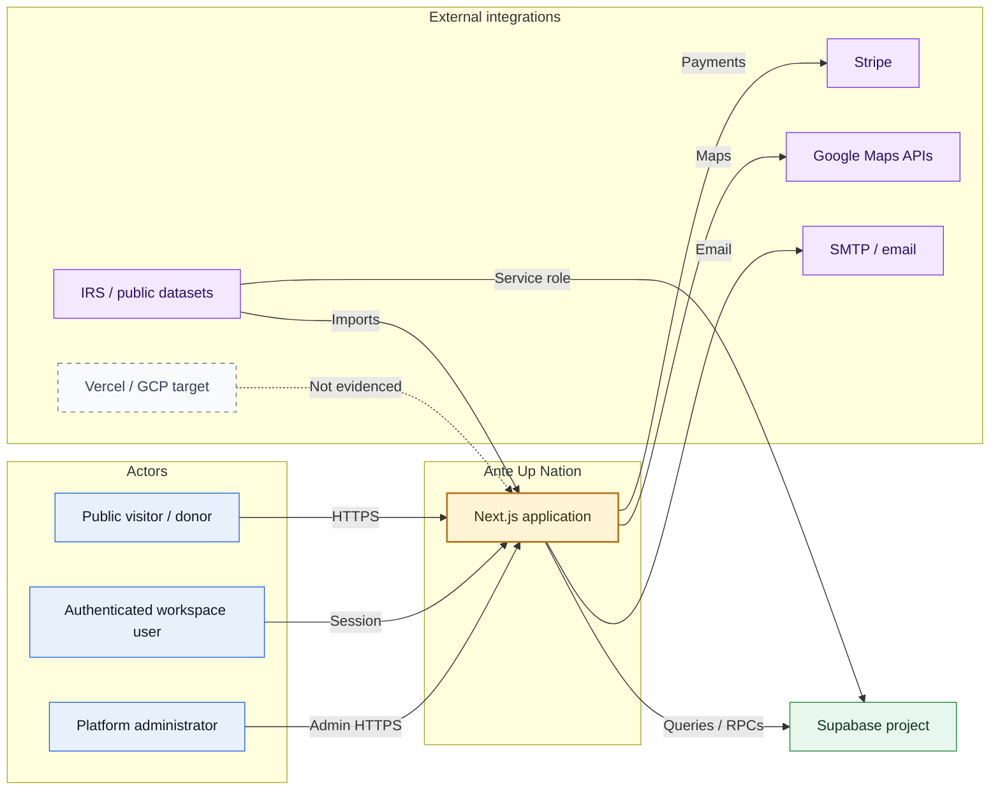
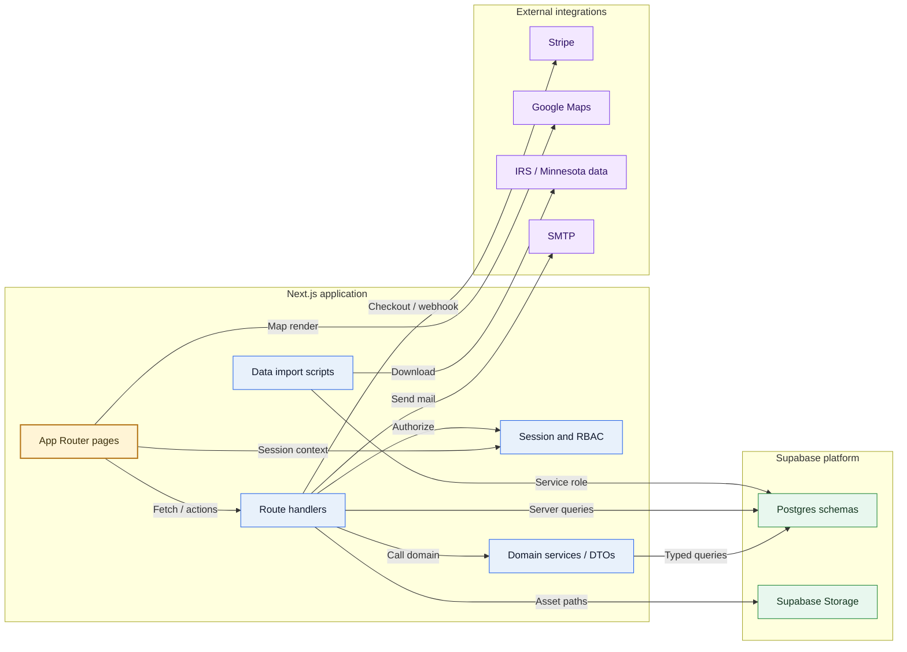

# 01 — System Context and Container Architecture

## Scope and evidence

This document describes the architecture evidenced by the current source tree, current Supabase migrations, `database.types.ts`, and the Next.js App Router. Archived migrations are treated as history, not as current runtime behavior. The repository identifies the product as pre-production in `README.md`.

Key evidence: `package.json`, `middleware.ts`, `utils/supabase/*`, `app/api/**`, `supabase/config.toml`, `supabase/migrations/**`, and the import scripts under `scripts/`.

## System context view

### Context interpretation

- Public and authenticated users enter through the same Next.js application. `middleware.ts` refreshes Supabase sessions and applies route-level admin/entity-admin redirects.
- Supabase is the system of record for the database, Auth, exposed schemas, RPCs, RLS and local Storage configuration. The app uses both the user-scoped server client and a service-role client in selected server/import paths.
- Stripe is a real integration: checkout routes create sessions and `/api/stripe/webhook` verifies signatures and upserts `donations`/`subscriptions`.
- Google Maps is a real client integration through `@react-google-maps/api`; Google geocoding is used by `scripts/geocode-nonprofit-addresses.ts`.
- IRS and Minnesota public-data ingestion are implemented as scripts, not as an in-request ETL service.
- No GCP SDK, Cloud Run/Functions manifest, Cloud Build file, Terraform/Pulumi module, `vercel.json`, or `.github/workflows/**` file was found. Vercel/GCP deployment is therefore an operational assumption or external configuration, not a repository-proven container.

## Container view

## Technology stack decision matrix

| Layer | Repository evidence | Why this choice fits the implemented system | Scalability / cost boundary visible in code |
|---|---|---|---|
| Web runtime | Next.js 16, React 19, App Router, server/client components | One codebase supports public pages, authenticated workspaces and API route handlers | Server work is request-bound; large imports are kept out of request paths and run as scripts |
| Web runtime — Alternatives considered | A separate SPA plus API service, Remix, or a traditional Node MVC application | A split frontend/backend would increase deployment and contract overhead for a product whose pages, authorization and route handlers already share one TypeScript boundary | An SPA could scale independently, but would add client data-fetching, auth handoffs and operational surfaces before those are needed |
| Web runtime — Architect recommendation | Keep Next.js for the product surface; formalize server-only boundaries and move long-running work to jobs as volume grows | This preserves the fast path for an authenticated workspace while making the runtime boundary explicit for interviewers, operators and future teams | Add request timeouts, background-job orchestration and observability before import or AI workloads approach platform limits |
| Language and contract | TypeScript 5.8, generated `database.types.ts`, domain DTOs | Strong compile-time contracts across route handlers, Supabase queries and UI | Generated types must be regenerated after migrations; stale types are a release risk |
| Language and contract — Alternatives considered | Plain JavaScript, GraphQL-generated types, or a hand-maintained API schema | JavaScript would reduce setup but weaken cross-layer guarantees; GraphQL could centralize contracts but would add a schema gateway and resolver model not evidenced here | The current DTO approach is lightweight, but its contract quality depends on migration/type-generation discipline and API tests |
| Language and contract — Architect recommendation | Keep TypeScript and generated database types; add versioned API schemas and contract tests at high-risk boundaries | Finance workflows benefit from explicit input validation, stable error shapes and traceable domain contracts—not just compile-time types | Add Zod or equivalent validation at route boundaries, then generate client contracts only where multiple consumers justify it |
| Styling/UI | Tailwind CSS, Radix slot, AG Grid, Framer Motion | Reusable responsive UI, data-heavy admin tables and interactive map/workspace components | Browser bundle and grid/map payload sizes are practical limits; map data is chunked and cached |
| Styling/UI — Alternatives considered | A component suite such as MUI, Chakra, or shadcn/ui; CSS Modules; a fully bespoke design system | Tailwind keeps styling close to components and avoids a large theme runtime; Radix primitives supply accessible behavior where needed | A larger suite could accelerate standard screens, but may create theming, bundle and customization costs across multi-entity branding |
| Styling/UI — Architect recommendation | Establish a small token layer for color, spacing, focus and density, then standardize table/form patterns | The current raw palette classes are productive but make accessibility and future entity branding harder to govern consistently | Add visual regression checks for finance/admin flows and measure AG Grid/map bundles before adding more client-side interaction |
| Data platform | Supabase Postgres 15, exposed schemas, RLS, RPCs | Relational integrity, tenant-aware policies, typed Data API access, database-side lifecycle rules | `supabase.config.toml` caps Data API responses at 1,000 rows; query/index design matters as data grows |
| Data platform — Alternatives considered | Managed PostgreSQL plus a custom API, Hasura, Firebase/Firestore, or a warehouse-first design | Supabase combines Postgres, Auth, Storage, RLS and local development in one platform; a custom API would offer more control at the cost of more infrastructure | Firestore would simplify some document-shaped features but weaken relational reporting, ledger integrity and SQL-based governance workflows |
| Data platform — Architect recommendation | Keep Postgres as the system of record and treat Supabase as an access platform, not the entire operating model | Finance capabilities need durable relational controls, auditable mutations, idempotency and tenant isolation | Add migration gates, query-performance checks, backups/restore drills and read models or a warehouse when reporting load competes with OLTP |
| Geospatial | PostGIS extension, GeoJSON, Turf/D3 geo, Google Maps | Stores geometry in Postgres while rendering/drilling into map features in the browser | Geometry payload size is a bottleneck; `/api/map/home` chunks IDs and uses simplified boundaries plus HTTP caching |
| Geospatial — Alternatives considered | Mapbox/MapLibre, a dedicated GIS service, vector tiles, or storing only external place IDs | Google Maps fits current geocoding and map rendering needs; PostGIS preserves authoritative spatial relationships and supports server-side filtering | A vector-tile or MapLibre path could reduce payloads and vendor coupling, but requires tile generation, styling and operational ownership |
| Geospatial — Architect recommendation | Keep PostGIS for truth and introduce vector-tile/generalized-boundary delivery if map coverage or concurrency grows | This separates spatial correctness from browser delivery performance and keeps the map API from becoming a large JSON bottleneck | Define zoom-level simplification, cache keys and a clear policy for geocoding quotas, attribution and provider failure |
| Authentication | Supabase Auth + `@supabase/ssr` cookies | Session refresh works across middleware, server components and route handlers | Token/session settings are in Supabase config; MFA is present only as disabled local configuration |
| Authentication — Alternatives considered | Auth0, Okta, Cognito, Clerk, or an internally managed identity service | External enterprise IdPs can provide mature federation and lifecycle controls; Supabase Auth minimizes integration surface for the current product | Switching providers would affect middleware, session claims, invitations, RLS assumptions and support processes—not just the login screen |
| Authentication — Architect recommendation | Keep Supabase Auth for now, but design an IdP boundary around claims, roles and tenant context | A finance architecture should make identity-provider replacement possible without rewriting authorization semantics | Enable MFA and SSO by environment/business need, centralize authorization decisions, and test session expiry, revocation and recovery paths |
| File storage | Supabase Storage references and bucket/path columns | Assets and IRS documents use stable bucket/path metadata | Local config sets a 50 MiB file limit; remote bucket policy is outside this repository |
| File storage — Alternatives considered | S3 plus CloudFront, GCS, Azure Blob, or a document-management platform | Supabase Storage keeps metadata and access policy near the database; cloud object storage may offer stronger lifecycle, retention and cross-region controls | A direct object-store design adds signed-URL, lifecycle, replication and malware-scanning responsibilities to the platform team |
| File storage — Architect recommendation | Keep stable object references in Postgres and move large or regulated document flows behind a storage abstraction | The abstraction makes retention, legal hold, scanning and provider migration explicit rather than embedding them in UI code | Add checksum/type validation, malware scanning, retention policies, audit events and private signed downloads before production finance use |
| Payments | Stripe SDK and client checkout | Stripe owns payment collection; webhook is the source of payment reconciliation events | Webhook idempotency relies on `stripe_session_id`/invoice upserts; retries and provider latency remain external |
| Payments — Alternatives considered | Adyen, Braintree, PayPal, processor-direct integrations, or a payment orchestration layer | Stripe offers strong developer tooling and a clean hosted-payment boundary; enterprise alternatives may improve regional methods, acquiring or negotiated economics | Processor choice affects settlement data, disputes, tax, payout reconciliation and operational support—not only checkout UX |
| Payments — Architect recommendation | Keep Stripe behind payment and reconciliation interfaces; make the internal ledger authoritative for business reporting | Provider events should drive state transitions, while the product retains an auditable record of what was expected, received and reconciled | Add an event inbox, idempotency keys, replay tooling, reconciliation reports and explicit handling for refunds, disputes and delayed webhooks |
| Public-data ingestion | `tsx` scripts, local caches under `data/`, service-role Supabase client | Handles large IRS XML/ZIP files and public datasets without blocking web requests | Disk/cache retention, IRS availability, parse variation and service-role blast radius are operational boundaries |
| Public-data ingestion — Alternatives considered | Airflow/Dagster, managed ETL, cloud batch jobs, streaming ingestion, or a warehouse-native pipeline | Scripts are appropriate while sources and cadence are limited; an orchestrator becomes valuable when retries, dependencies and schedules multiply | Managed pipelines reduce operational toil but introduce platform cost, vendor-specific connectors and another place to secure service credentials |
| Public-data ingestion — Architect recommendation | Keep scripts for repeatable local/import logic, then wrap them in observable idempotent jobs with checkpoints | This provides a migration path from developer-run imports to controlled production operations without rewriting parsers | Record source version, checksum, run status, row counts and rejects; isolate service-role credentials and make reruns safe |
| Email | Nodemailer | Supports invite, invoice and contact delivery without coupling domain code to one vendor | Delivery depends on SMTP configuration; local Supabase email is captured by Inbucket |
| Email — Alternatives considered | SendGrid, Postmark, SES, Mailgun, or a transactional messaging platform | SMTP is a small initial dependency; managed providers improve deliverability, templates, bounce handling and operational visibility | Provider lock-in is manageable when domain code emits message intents rather than constructing provider-specific requests everywhere |
| Email — Architect recommendation | Introduce a notification interface with templates, delivery status and correlation IDs | Finance workflows need evidence that a notice was generated, accepted and possibly delivered—not merely that a send call returned | Add outbox delivery, retry/backoff, bounce suppression, SPF/DKIM/DMARC ownership and a testable template catalog |
| AI governance primitives | AI account, credit ledger, usage events, agent runs and safety policy JSONB | Establishes budget, usage and audit records for entity-scoped AI capabilities | Current repository proves accounting/control tables and governance RPCs; it does not prove a specific external model provider |
| AI governance primitives — Alternatives considered | Direct model calls from route handlers, a hosted agent platform, a model gateway, or an event-driven AI worker | The repository-first governance model avoids coupling accounting and safety to one provider or framework | Direct calls are faster to prototype but make spend limits, retries, prompt/version tracking and provider substitution harder to control |
| AI governance primitives — Architect recommendation | Keep provider calls behind a model gateway and require every run to emit budget, policy, model and outcome metadata | This supports controlled experimentation while preserving auditability and tenant-level cost allocation | Add approval tiers, prompt/model versioning, PII handling, timeout/circuit-breaker policy and human review for consequential finance actions |
| Delivery infrastructure | `package.json` scripts and local Supabase config | Reproducible local development and migration reset workflows | No committed Vercel/GCP manifest or CI workflow; promotion, secrets and rollback are not codified here |
| Delivery infrastructure — Alternatives considered | Vercel-first deployment, Cloud Run/Cloud Build, Kubernetes, or a platform-as-code baseline using Terraform/Pulumi | Vercel reduces web deployment friction; Cloud Run/GCP may fit batch, network and enterprise controls; Kubernetes is likely too much platform for this stage | The key decision is less about hosting brand and more about whether web, workers, imports and secrets have clear promotion and rollback boundaries |
| Delivery infrastructure — Architect recommendation | Codify the target topology and promotion path before production: web, worker, database, storage, secrets and observability | A senior architect should be able to explain how a financial defect is detected, contained, rolled back and reconciled | Add CI migration checks, preview environments, IaC, secret rotation, SLOs, structured logs/traces, backups and a tested rollback/runbook path |

## Interview cheat sheet

Use the matrix to answer architecture questions in a consistent sequence: name the decision, point to repository evidence, explain the tradeoff, state the boundary, and finish with the next control you would add before scale or production risk increases.

| Likely question | Strong answer shape |
|---|---|
| Why Next.js instead of a separate frontend and API? | It keeps public pages, authenticated workspaces and route handlers in one typed delivery unit. I would preserve that simplicity while moving long-running imports and AI work to observable workers. |
| How do you protect tenant and finance data? | Use Postgres constraints and RLS for the data boundary, explicit authorization in route/domain layers, server-only service-role paths, and audit/idempotency controls for mutations and provider events. |
| What happens when the system outgrows Supabase? | Keep Postgres-compatible data contracts and isolate provider-specific access. Scale read models, workers, storage and observability independently before considering a platform migration. |
| How would you make payments reliable? | Treat Stripe webhooks as external events, make handlers idempotent, persist an internal ledger/reconciliation state, support replay, and distinguish authorization, capture, refund, dispute and settlement states. |
| What is the current production gap? | The repository proves application and local platform behavior, but not the hosted deployment topology, CI promotion, secret rotation, observability or rollback process. Those are the first operational controls I would codify. |
| How would you approach public-data ingestion? | Keep parsing out of request paths, record source/version/checksum and run metadata, checkpoint work, isolate service credentials, and make imports safe to retry without duplicating facts. |
| How do you evaluate an AI feature in finance? | Start with policy, budget and audit primitives; then add provider abstraction, prompt/model versioning, PII controls, confidence thresholds and human review for consequential actions. |
| When would you replace a vendor? | Not because an alternative is fashionable: define the failure, cost, compliance or capability threshold first, then isolate the boundary so the decision is reversible and measurable. |

### Executive takeaway

The current architecture is a pragmatic product-stage system: one web runtime, a relational system of record, managed identity/storage, provider-owned payment collection, and scripts for heavy public-data work. The senior-architect opportunity is to preserve that speed while adding the controls that finance demands: explicit authorization, auditability, idempotency, reconciliation, operational visibility and tested recovery.

## Architecture boundaries and risks

1. The service-role client is intentionally used for Stripe webhooks, map home aggregation and import scripts. Those paths must remain server-only and must not accept arbitrary tenant writes without explicit validation.
2. Several public-facing views use `Cache-Control`, `revalidate`, or `no-store`; this is deliberate but not centrally standardized.
3. The repository has local Supabase configuration, but hosted Supabase, Vercel, GCP, DNS, observability and secret-rotation settings are external to source control.
