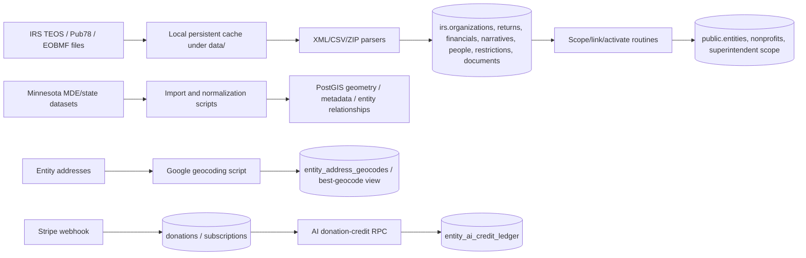

# 02 — Data Model and Governance

## Schema source of truth

The ERD below is derived from `database.types.ts` and the current ordered migrations in `supabase/migrations/`. It includes current tables/views and omits archived-only objects. Columns shown are primary identifiers and relationship-bearing fields; the full column contract remains the generated TypeScript database definition and SQL migrations.

## Complete current-schema ERD

```mermaid
erDiagram
  profiles ||--o{ entity_users : "membership"
  profiles ||--o{ entity_user_invites : "invites"
  profiles ||--o{ entity_person_roles : "linked user"
  entities ||--o{ entity_users : "tenant membership"
  entities ||--o{ entity_person_roles : "people roles"
  entities ||--o{ entity_person_claims : "claims"
  entities ||--o{ entity_contacts : "contacts"
  entities ||--o{ entity_addresses : "addresses"
  entity_addresses ||--o{ entity_address_geocodes : "geocodes"
  entities ||--o{ entity_geometries : "map geometry"
  entities ||--o{ entity_relationships : "source entity"
  entities ||--o{ entity_relationships : "target entity"
  entities ||--o{ entity_source_records : "source records"
  entities ||--o{ entity_attributes : "namespaced attrs"
  entities ||--o{ entity_status : "lifecycle"
  entities ||--o{ entity_onboarding_progress : "onboarding"
  entities ||--o{ entity_field_overrides : "field overrides"
  entities ||--o{ documents : "documents"
  documents ||--o{ document_versions : "versions"
  entities ||--o{ donations : "beneficiary"
  entities ||--o{ subscriptions : "beneficiary"
  entities ||--o{ businesses : "business record"
  entities ||--o{ nonprofits : "nonprofit record"
  entities ||--o{ district_metadata : "district metadata"
  entities ||--o{ superintendent_scope_nonprofits : "district scope"

  entities ||--o{ boards : "governance owner"
  boards ||--o{ board_members : "members"
  board_members ||--o{ meeting_attendance : "attendance"
  board_meetings ||--o{ meeting_attendance : "meeting"
  board_meetings ||--o{ meeting_minutes : "minutes"
  board_meetings ||--o{ motions : "motions"
  motions ||--o{ votes : "votes"
  entities ||--o{ approvals : "approval target owner"
  meeting_minutes ||--o{ approvals : "approval target"
  document_versions ||--o{ approvals : "approval target"

  irs_organizations ||--o{ irs_entity_links : "EIN link"
  entities ||--o{ irs_entity_links : "linked entity"
  irs_organizations ||--o{ irs_returns : "EIN"
  irs_returns ||--o| irs_return_financials : "financials"
  irs_returns ||--o{ irs_return_documents : "documents"
  irs_returns ||--o{ irs_return_narratives : "narratives"
  irs_returns ||--o{ irs_return_people : "people"
  irs_returns ||--o{ irs_return_restrictions : "restrictions"
  irs_return_narratives ||--o{ irs_return_restrictions : "source narrative"

  entities ||--o| business_profiles : "bookkeeping profile"
  entities ||--o{ business_systems : "accounting systems"
  business_systems ||--o{ business_financial_accounts : "accounts"
  entities ||--o{ business_financial_accounts : "tenant accounts"
  entities ||--o{ business_service_engagements : "engagements"
  business_service_engagements ||--o{ business_time_entries : "time"
  business_service_engagements ||--o{ business_invoices : "invoices"
  business_invoices ||--o{ business_time_entries : "billed time"
  entities ||--o{ business_recurring_tasks : "recurring work"
  entities ||--o{ business_responsibilities : "responsibility"
  entities ||--o{ business_close_templates : "close templates"
  business_close_templates ||--o{ business_close_template_tasks : "template tasks"
  entities ||--o{ business_close_periods : "close periods"
  business_close_periods ||--o{ business_close_tasks : "close tasks"
  business_close_template_tasks ||--o{ business_close_tasks : "instantiated task"

  entities ||--o| entity_ai_accounts : "AI account"
  entity_ai_accounts ||--o{ entity_ai_credit_ledger : "credit ledger"
  entities ||--o{ entity_ai_credit_ledger : "credit owner"
  entities ||--o{ entity_ai_usage_events : "usage"
  entities ||--o{ entity_agents : "agent"
  entity_agents ||--o{ entity_agent_runs : "runs"
  entity_agent_runs ||--o{ entity_ai_usage_events : "usage event"

  branding_assets }o--|| entities : "entity_id"
  branding_palettes }o--|| entities : "entity_id"
  branding_palette_colors }o--|| branding_palettes : "palette_id"
  branding_patterns }o--|| entities : "entity_id"
  branding_typography }o--|| entities : "entity_id"

  entity_types {
    text key PK
    text label
  }
  entity_status {
    uuid entity_id FK
    text status
  }
  entity_attributes {
    uuid entity_id FK
    text namespace
    jsonb attrs
  }
  entity_contacts {
    uuid id PK
    uuid entity_id FK
    text source_system
  }
  entity_field_overrides {
    uuid entity_id FK
    text field_name
    jsonb value
  }
  entity_geometries {
    uuid entity_id FK
    text geometry_type
    jsonb geojson
  }
  entity_onboarding_progress {
    uuid entity_id FK
    text step
    text status
  }
  entity_person_claims {
    uuid id PK
    uuid entity_id FK
    text source_person_id
    text email
  }
  entity_source_records {
    uuid id PK
    uuid entity_id FK
    text source_system
  }
  entity_user_invites {
    uuid id PK
    uuid entity_id FK
    text email
  }
  service_providers {
    uuid id PK
    uuid entity_id FK
    text status
  }
  service_offerings {
    uuid id PK
    uuid provider_id FK
    text name
  }
  service_offering_prices {
    uuid id PK
    uuid offering_id FK
    numeric amount
  }
  service_locations {
    uuid id PK
    uuid service_offering_id FK
    text address
  }
  service_availability_rules {
    uuid id PK
    uuid offering_id FK
    text rule
  }
  messages {
    bigint id PK
    uuid user_id FK
    text body
  }
  school_program_location_metadata {
    uuid entity_id FK
    text loctype
  }
  mde_states {
    text code PK
    text name
  }
  mde_org_types {
    text code PK
    text label
  }
  mde_school_class_types {
    text code PK
    text label
  }
  ai_credit_rates {
    uuid id PK
    integer usd_cents_per_credit
  }
  action_items {
    uuid id PK
    uuid meeting_id FK
    uuid motion_id FK
    uuid agent_run_id FK
    text status
  }
  agent_runs {
    uuid id PK
    uuid meeting_id FK
    text status
  }

  entities ||--o{ entity_status : "status"
  entities ||--o{ entity_attributes : "attributes"
  entities ||--o{ entity_contacts : "contacts"
  entities ||--o{ entity_field_overrides : "overrides"
  entities ||--o{ entity_geometries : "geometry"
  entities ||--o{ entity_onboarding_progress : "progress"
  entities ||--o{ entity_person_claims : "claims"
  entities ||--o{ entity_source_records : "source records"
  entities ||--o{ entity_user_invites : "invites"
  entities ||--o{ service_providers : "provider entity"
  service_providers ||--o{ service_offerings : "offers"
  service_offerings ||--o{ service_offering_prices : "prices"
  service_offerings ||--o{ service_availability_rules : "availability"
  service_offerings ||--o{ service_locations : "locations"
  entities ||--o{ school_program_location_metadata : "school location"
  board_meetings ||--o{ action_items : "actions"
  board_meetings ||--o{ agent_runs : "assistant runs"

  entities {
    uuid id PK
    text entity_type
    text name
    text slug
    jsonb external_ids
    boolean active
  }
  profiles {
    uuid id PK
    text role
    text status
  }
  entity_users {
    uuid id PK
    uuid entity_id FK
    uuid user_id FK
    entity_user_role role
    text status
  }
  entity_relationships {
    uuid id PK
    uuid source_entity_id FK
    uuid target_entity_id FK
    text relationship_type
  }
  nonprofits {
    uuid id PK
    uuid entity_id FK
    text ein
  }
  businesses {
    uuid id PK
    uuid entity_id FK
    text place_id
    text status
  }
  district_metadata {
    uuid entity_id PK
    text sdorgid
    text web_url
  }
  superintendent_scope_nonprofits {
    uuid district_entity_id FK
    text ein
    text status
    text tier
  }
  documents {
    uuid id PK
    uuid entity_id FK
    document_type document_type
    document_visibility visibility
    uuid current_version_id FK
  }
  document_versions {
    uuid id PK
    uuid document_id FK
    document_version_status status
    uuid approved_by FK
    uuid approved_by_meeting_id FK
  }
  boards {
    uuid id PK
    uuid entity_id FK
  }
  board_meetings {
    uuid id PK
    uuid board_id FK
    meeting_status status
  }
  board_members {
    uuid id PK
    uuid board_id FK
    uuid user_id FK
    text role
  }
  meeting_minutes {
    uuid id PK
    uuid meeting_id FK
    minutes_status status
    uuid amended_from_id FK
  }
  motions {
    uuid id PK
    uuid meeting_id FK
  }
  votes {
    uuid id PK
    uuid motion_id FK
    uuid board_member_id FK
    uuid user_id FK
  }
  approvals {
    uuid id PK
    uuid entity_id FK
    uuid board_member_id FK
    uuid target_id
  }
  irs_organizations {
    text ein PK
    text legal_name
    text normalized_legal_name
  }
  irs_entity_links {
    text ein FK
    uuid entity_id FK
    text match_type
    numeric confidence
  }
  irs_returns {
    uuid id PK
    text ein FK
    irs_return_type return_type
    integer tax_year
  }
  irs_return_financials {
    uuid return_id PK,FK
    numeric total_revenue
    numeric total_expenses
    numeric net_assets_end
  }
  irs_return_documents {
    uuid id PK
    uuid return_id FK
    irs_doc_type doc_type
    text sha256
  }
  irs_return_narratives {
    uuid id PK
    uuid return_id FK
    irs_narrative_section section
    jsonb extracted
  }
  irs_return_people {
    uuid id PK
    uuid return_id FK
    irs_person_role role
    numeric reportable_compensation
  }
  irs_return_restrictions {
    uuid id PK
    uuid return_id FK
    irs_restriction_type restriction_type
  }
  business_profiles {
    uuid id PK
    uuid entity_id FK
    text legal_name
    text bookkeeping_status
  }
  business_systems {
    uuid id PK
    uuid entity_id FK
    text system_type
  }
  business_financial_accounts {
    uuid id PK
    uuid entity_id FK
    uuid system_id FK
    text account_type
  }
  business_service_engagements {
    uuid id PK
    uuid entity_id FK
    uuid client_entity_id FK
  }
  business_time_entries {
    uuid id PK
    uuid engagement_id FK
    uuid invoice_id FK
  }
  business_invoices {
    uuid id PK
    uuid entity_id FK
    uuid engagement_id FK
  }
  business_recurring_tasks {
    uuid id PK
    uuid entity_id FK
  }
  business_responsibilities {
    uuid id PK
    uuid entity_id FK
    uuid system_id FK
    uuid account_id FK
  }
  business_close_templates {
    uuid id PK
    uuid entity_id FK
  }
  business_close_template_tasks {
    uuid id PK
    uuid template_id FK
  }
  business_close_periods {
    uuid id PK
    uuid entity_id FK
    text status
  }
  business_close_tasks {
    uuid id PK
    uuid close_period_id FK
    uuid entity_id FK
    text status
  }
  entity_ai_accounts {
    uuid id PK
    uuid entity_id FK
    integer hard_limit_credits
  }
  entity_ai_credit_ledger {
    uuid id PK
    uuid entity_id FK
    uuid account_id FK
    text source_type
    integer amount_credits
  }
  entity_ai_usage_events {
    uuid id PK
    uuid entity_id FK
    uuid agent_run_id FK
    integer billed_credits
  }
  entity_agents {
    uuid id PK
    uuid entity_id FK
    jsonb safety_policy
  }
  entity_agent_runs {
    uuid id PK
    uuid entity_id FK
    uuid agent_id FK
    text status
  }
  branding_assets {
    uuid id PK
    uuid entity_id FK
    text bucket
    text path
  }
  branding_palettes {
    uuid id PK
    uuid entity_id FK
    text role
  }
  branding_palette_colors {
    uuid id PK
    uuid palette_id FK
    integer slot
  }
  branding_patterns {
    uuid id PK
    uuid entity_id FK
  }
  branding_typography {
    uuid id PK
    uuid entity_id FK
  }
```

### Tables not expanded in the diagram

The current `public` schema also contains `ai_credit_rates`, `service_availability_rules`, `service_locations`, `service_offering_prices`, `service_offerings`, `service_providers`, `entity_types`, `entity_status`, `entity_attributes`, `entity_contacts`, `entity_field_overrides`, `entity_geometries`, `entity_onboarding_progress`, `entity_person_claims`, `entity_source_records`, `mde_org_types`, `mde_school_class_types`, `mde_states`, `messages`, `school_program_location_metadata`, `subscriptions`, and supporting views such as `v_district_scope_nonprofits`, `v_entity_best_geocode`, `latest`/summary views, and `user_profiles_with_roles`. Their presence is verified in `database.types.ts`; relationship-bearing fields are represented in the ERD where they connect to the core tenant graph.

## Tenant and hierarchy model

`public.entities` is the polymorphic root. `entity_type` is text-backed and is used in code for states, districts, nonprofits, businesses and other public/service entities. `entity_users` supplies the workspace boundary with roles `admin`, `editor`, `viewer`, and `employee`. District scope is represented by `superintendent_scope_nonprofits` keyed by district entity plus EIN. IRS records are keyed by EIN and linked to app entities through `irs.entity_links`.

This is a shared-database, shared-schema multi-tenant model. Tenant isolation is policy-driven rather than database-per-tenant. Public reference/entity data is intentionally readable in several tables; private or tenant-scoped data uses entity/admin/self policies.

## Integrity and auditability controls

- UUID primary keys and foreign keys are used throughout the core model; many destructive cascades are explicit in current migrations.
- Check constraints enforce tax-year bounds, tax-period order, EIN shape, status enumerations, invoice/close-period windows, AI credit non-negativity, and financial identity checks such as net assets equals assets less liabilities where all values are present.
- `updated_at` triggers are used in public, branding and business schemas.
- Governance functions and triggers enforce meeting lifecycle, quorum, vote timing, minutes versioning, immutability after approval, packet consistency and finalized-motion protection.
- `governance.approvals` stores signature hash, approval method, IP address, approving board member and timestamp.
- Document versions preserve content/storage hash metadata, status, approver and approval meeting.
- AI credit ledger and usage events are append-oriented accounting records with unique source keys for donation-credit idempotency.
- IRS records preserve source maps, source URLs/IDs, raw narrative text, SHA-256 document references and created/updated timestamps.

## Indexing and query strategies

- Composite indexes in the business schema target `(entity_id, status/date/type)` and foreign-key joins.
- AI ledger, usage and agent-run indexes target `(entity_id, created_at desc)`.
- IRS normalized EIN and organization search use dedicated migrations and `pg_trgm` support for organization search.
- Geospatial data uses PostGIS and GeoJSON columns/derived geometry; map home explicitly chunks entity IDs in batches of 200.
- Views such as `latest_returns`, `latest_financials`, `v_district_scope_nonprofits`, `v_entity_best_geocode`, `entity_donation_totals` and AI summaries avoid repeating aggregation logic in clients.
- Supabase API `max_rows = 1000` is a hard payload boundary for local/API configuration; callers should paginate, scope, or use summary views.

## Ingestion and ETL pipelines

The ETL is batch/script-driven and requires `SUPABASE_SERVICE_ROLE_KEY` for writes. The repository contains cache directories and logging directories, but no scheduler/orchestrator manifest; execution cadence is operationally supplied.
