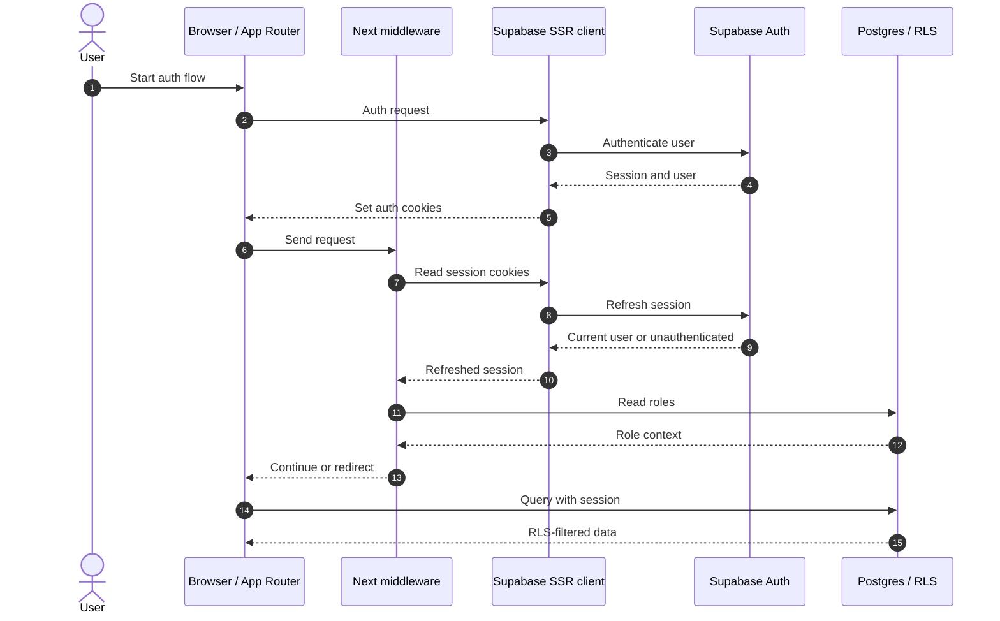
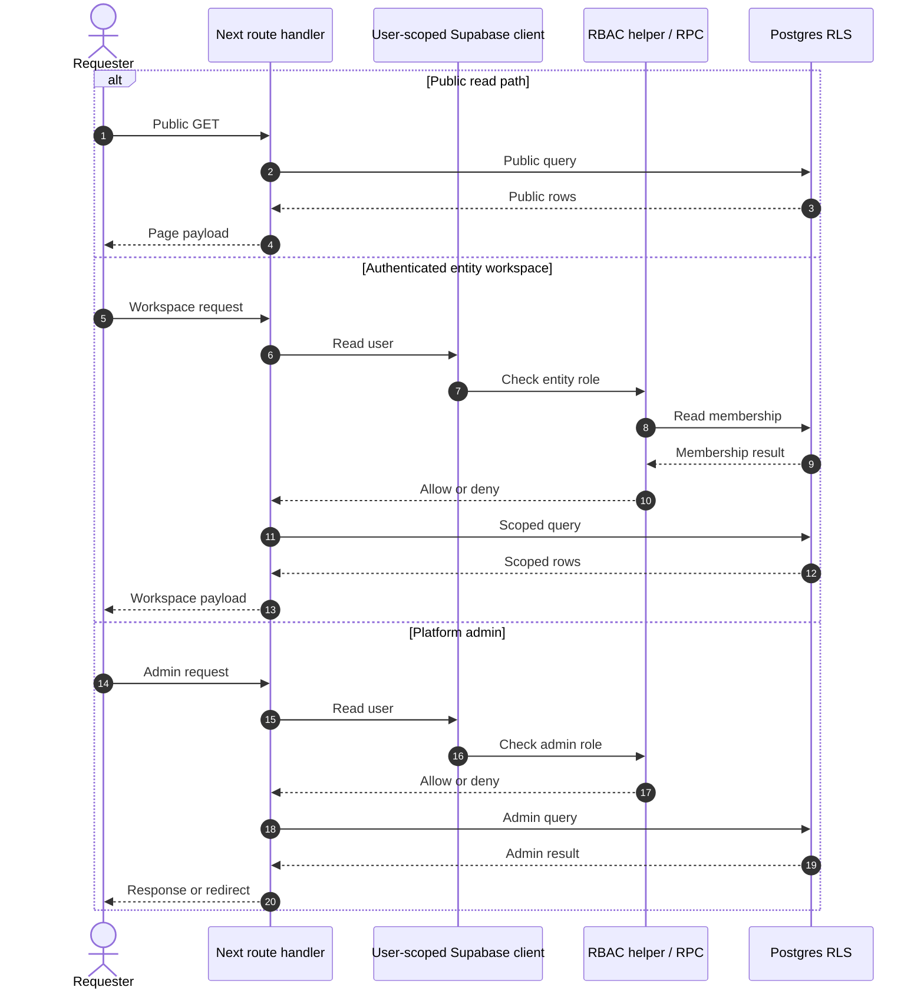

# 03 — Security, RBAC and Compliance

## Security model at a glance

The effective control plane has four layers: Supabase Auth session cookies; Next.js middleware route redirects; server-side authorization helpers; and database grants/RLS/RPC controls. The database is the final tenant boundary for Supabase-authenticated access, while service-role paths bypass RLS and are restricted to server/import/webhook code by convention.

## Authentication and session handling

Evidence: `middleware.ts`, `utils/supabase/middleware.ts`, `utils/supabase/server.ts`, `app/auth/**`, `app/lib/auth/platformAdmin.ts`, and `supabase/config.toml`. Local Auth has refresh-token rotation enabled, one-hour JWT expiry, signup enabled, anonymous sign-in disabled, and MFA enrollment/verification disabled in the committed local config.

## Public versus workspace authorization

## RLS policy summary

The current migrations show these policy families:

- Public reference/entity tables are enabled for RLS and generally receive `SELECT` for `anon, authenticated`. Their write policies require entity admin or global admin via `public.is_entity_admin(...)` / `public.is_global_admin(...)`.
- `donations` and `subscriptions` are private-by-default for reads: anonymous/authenticated insert is allowed for checkout completion, self reads are limited by `user_id = auth.uid()`, and entity/global admins receive administrative access. `entity_donation_totals` provides an aggregate view for public totals; later security-lint remediation sets views to `security_invoker`.
- `entity_person_roles` is readable by global admins, entity admins, or the linked user; writes are entity-admin/global-admin only.
- `entity_user_invites` is readable/updateable by global/entity admins or the invitee email; creation/deletion is admin-only.
- Governance tables are policy-backed by `governance.can_read_*`, board/member/officer functions and lifecycle RPCs. The server helper also checks active board membership before board operations.
- Business schema tables are RLS-enabled in the bookkeeping migrations. The route layer separately checks global admin or active entity membership/admin role before reads/writes.
- IRS data exposes latest/summary views and organization data according to current grants/RLS migrations; imports use service role.
- A September 2026 migration revokes broad default privileges for future public tables, requiring each new migration to declare API grants explicitly.

## API authorization enforcement

- `utils/supabase/route.ts` creates a request-scoped client using cookies.
- `app/lib/server/route-context.ts` standardizes `getUserOrThrow`, entity-ID parsing, JSON responses and error mapping for bookkeeping/workspace routes.
- `app/lib/server/rbac.ts` implements `requireEntityUser`, `requireEntityAdmin`, `requireEntityManager`, `requireGlobalAdmin` and `requireBoardMember`.
- `app/lib/auth/assertAdmin.ts` accepts a server-side `ADMIN_ALLOWLIST`/`NEXT_PUBLIC_ADMIN_ALLOWLIST` or `profiles.role = 'admin'`.
- `utils/supabase/middleware.ts` protects `/admin`, `/users`, and entity `Admin` tabs; other public tabs continue through to their own page/API controls.
- `safeRoute` catches route errors, logs a contextual error and returns JSON 500 responses; not all legacy/public routes use the same helper, so authorization review remains route-specific.

## Secret management and trust zones

The repository references environment variables for Supabase URL/anon key/service-role key, Stripe secret/webhook secret, Google Maps/geocoding keys, mail transport, admin allowlists and IRS cache locations. `.env*` files are consumed by scripts but are not committed in the file inventory. `supabase/config.toml` uses `env(...)` substitution for sensitive local settings.

Trust zones:

1. Browser: public/anon key and browser-visible Google Maps key only.
2. Next server/API: cookie-backed user client plus server-only secrets.
3. Webhook/import workers: service-role Supabase key and external provider secrets; must never be bundled for the browser.
4. Postgres: RLS, grants, SECURITY DEFINER functions with explicit `search_path`, constraints and lifecycle triggers.

## Compliance posture and limitations

The design supports least privilege, tenant scoping, approval evidence, immutable/finalized governance artifacts, versioned documents, source maps and payment reconciliation. It also models segregation of duties through separate entity roles, board officers/members, admin-only operations and approval targets.

This is an architectural control assessment, not a certification. The repository does not prove formal SOC 2/PCI/HIPAA controls, centralized audit-log retention, SIEM integration, production key rotation, backup/restore testing, or an enforced deployment separation between staging and production. Those are recommended operational controls outside the current code evidence.
