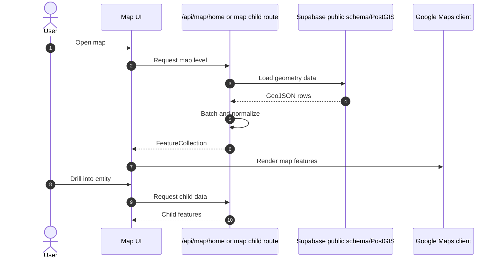
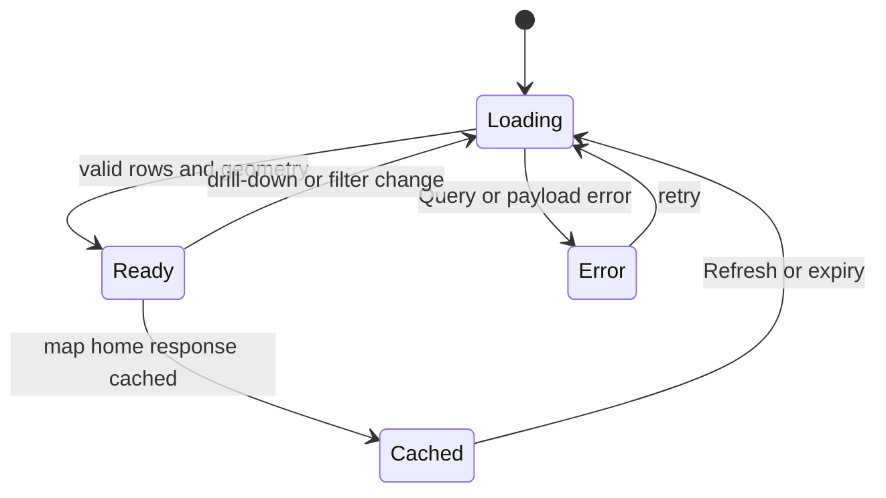
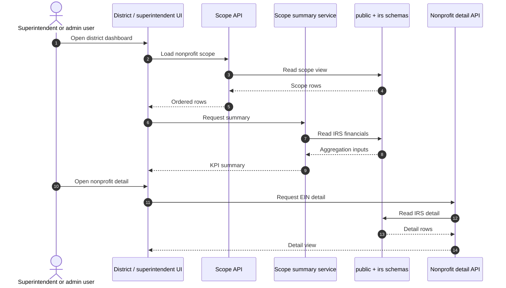
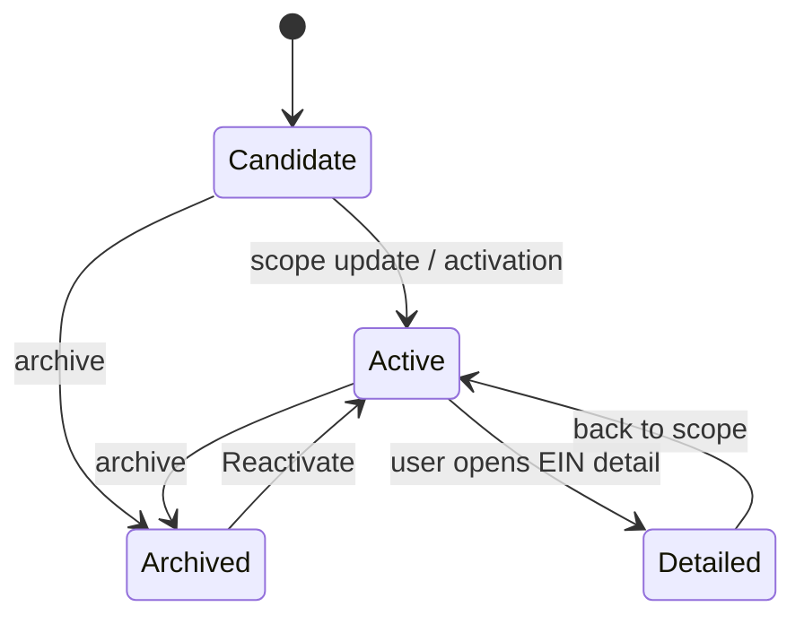
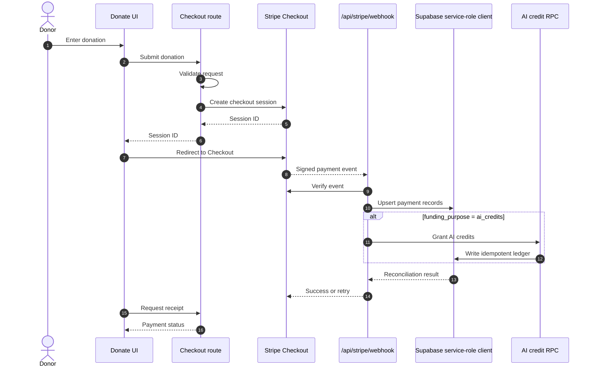
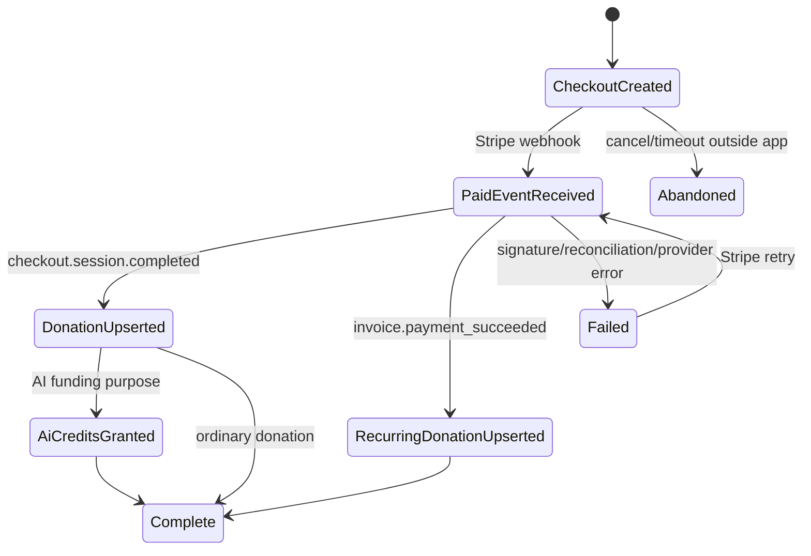

# 04 — Key Business Workflows

The three workflows below are selected because they have clear end-to-end implementations in the repository: map/geospatial drill-down, nonprofit/IRS scope aggregation, and payment-to-donation/AI-credit reconciliation. The repository also contains extensive governance and bookkeeping workflows; those are documented in the schema and RBAC documents and are not presented as a fourth “top” workflow here.

## Workflow 1 — Geospatial filtering and drill-down

Evidence and controls:

- `/api/map/home` is `force-static`, has `revalidate = 3600`, emits `s-maxage=3600` and `stale-while-revalidate=86400`, and logs request/step timings.
- It chooses simplified boundaries when both simplified and full geometry exist, chunks state IDs by 200, validates UUIDs, ignores malformed geometries, and returns GeoJSON FeatureCollections.
- Other entity geometry helpers use `cache: "no-store"` for interactive detail calls.
- Likely bottlenecks are geometry payload volume, Supabase round trips, client rendering and Google Maps script load. The code mitigates only the first two through simplification, batching and caching.
- Errors are logged with request IDs/timings in the home route and returned as HTTP 500 JSON; malformed geometry is skipped rather than crashing the response.

## Workflow 2 — District nonprofit scope, financial aggregation and detail drill-down

Evidence and controls:

- Scope status values are `candidate`, `active`, `archived`; tiers are `registry_only`, `disclosure_grade`, `institutional` in the scope route types.
- The scope GET route uses `v_district_scope_nonprofits`; PATCH validates arrays, status/tier enums, and updates district+EIN pairs in parallel.
- IRS overview routes query `irs.entity_links`, `irs.organizations`, `irs.latest_returns`, `irs.latest_financials`, narratives, people and restrictions.
- The detail UI explicitly uses `cache: "no-store"`; this avoids stale onboarding/scope state but increases database load.
- Aggregation latency is dominated by cross-schema joins, latest-return views and payload size. The repository uses summary views/RPCs but does not show a distributed cache or materialized refresh scheduler.
- `safeRoute` maps thrown failures to JSON 500; client routes commonly surface non-OK responses to the UI.

## Workflow 3 — Entity donation/payment and AI-credit reconciliation

Evidence and controls:

- Checkout routes use `STRIPE_SECRET_KEY`; the webhook uses `STRIPE_WEBHOOK_SECRET` and `SUPABASE_SERVICE_ROLE_KEY`.
- Webhook signature verification occurs before event processing.
- Donations upsert on `stripe_session_id`; invoice events update by `invoice_id`; subscriptions upsert on `stripe_subscription_id`.
- The AI credit RPC is idempotent on `(entity_id, source_type, source_id, direction)`, enforces positive amounts and active accounts, and writes ledger/usage records.
- Error handling returns 400 so Stripe can retry; database/provider failures are logged. Duplicate event safety is implemented for the main keys, but replay/partial-failure observability is not centralized in-repo.
- External Stripe latency and webhook retry timing are the main bottlenecks; the application does not block the checkout redirect on database reconciliation.

## Cross-workflow caching and failure posture

| Concern | Implemented behavior |
|---|---|
| Server/static caching | Map home uses static generation, `revalidate=3600`, and CDN cache headers |
| Client data caching | Small in-memory cached-resource helpers and React Query provider exist; many detail requests explicitly use `no-store` |
| Cache invalidation | Selected actions call `revalidatePath`; no central cache-invalidation bus is present |
| API errors | `safeRoute`, `jsonError`, `console.error`, request/timing logs in selected routes |
| External retries | IRS scripts include cache/backoff behavior; Stripe relies on webhook retry; browser fetch callers commonly retry manually or surface errors |
