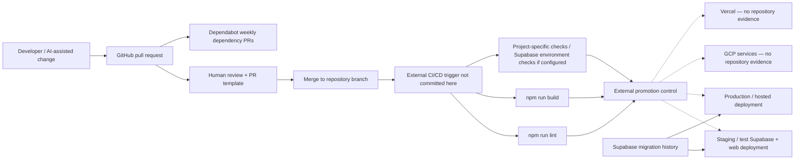
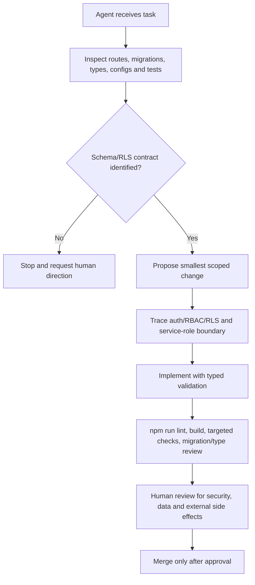

# 05 — SDLC, CI/CD and AI Governance

## Repository delivery evidence

The repository contains `package.json` scripts for lint, build, local Supabase reset/seed, generated types, environment checks, imports and verification. It contains Dependabot configuration, a pull-request checklist, Copilot instructions and a security policy. It does not contain `.github/workflows/**`, `vercel.json`, `cloudbuild.yaml`, a Dockerfile, Terraform/Pulumi, or other provider-specific deployment manifests.

Accordingly, the diagram below distinguishes the observed source-control checks from the deployment path that is not codified in this repository.

## GitHub to deployment boundary

### What is implemented versus absent

Implemented in the repository:

- `npm run lint` invokes ESLint.
- `npm run build` runs Tailwind generation and `next build --webpack`.
- Local Supabase startup/reset/status, seeds, generated types, environment assertions and verification scripts are available.
- `supabase/migrations/` is the ordered database change history; `database.types.ts` is the generated application contract.
- Dependabot opens weekly npm update PRs with a five-PR limit.
- `.github/copilot-instructions.md` sets TypeScript/React/naming/error-handling expectations; `.github/SECURITY.md` directs vulnerability reports to private GitHub reporting.

Not evidenced:

- No automatic GitHub checks or deployment workflow.
- No explicit staging-to-production environment promotion policy.
- No Vercel project configuration, preview deployment configuration or GCP runtime configuration.
- No migration approval gate, artifact provenance check, security scanner, SBOM generation, secret scanner or automated rollback definition.

## Environment and promotion model grounded in scripts

The repository supports local Supabase and named remote environment files: `.env.local`, `.env.supabase.local.generated`, `.env.dev.cloud`, and `.env.test.cloud` are referenced by `package.json` scripts. Test scripts include `assert:test` and `seed:test`; import commands have `:dev`, `:test`, and local variants. This indicates a dev/test separation in developer workflows, but production promotion is not encoded.

Recommended enterprise promotion control, clearly marked as a required external control rather than current functionality: pull request checks → migration/type compatibility check → deploy to test Supabase/web target → smoke checks → explicit approval → production migration and web deploy → rollback/restore plan.

## AI-Assisted Engineering & Governance Standard

### Purpose

AI agents may accelerate implementation and analysis, but the repository’s schema, authorization and operational boundaries remain authoritative. An agent must not treat prose, stale generated types, archived migrations or a guessed deployment target as the source of truth.

### Mandatory constraints

1. **Schema contract first.** Before changing database access, inspect the current ordered migration set and `database.types.ts`. New tables must declare explicit API grants after `20260923130000_require_explicit_public_table_grants.sql`; new fields must be reflected in generated types.
2. **RLS is a security boundary.** Every exposed table must have an intentional RLS posture. Entity-scoped data must use `entity_id`/district scope or a documented public aggregate. Agents must not replace a user-scoped client with the service-role client to “make a query work.”
3. **Authorization is defense in depth.** Route handlers must authenticate, enforce global/entity/board role checks where applicable, validate input, and rely on database RLS/RPC checks. UI hiding is never sufficient authorization.
4. **Service-role isolation.** Service-role access is limited to server-only webhook/import/administrative paths. It must not be imported into client components or exposed through serialized props, logs or error messages.
5. **Lifecycle and financial invariants.** Governance finalization, approvals, document locks, Stripe idempotency, AI credit accounting, tax-year bounds and bookkeeping state constraints must be preserved. Direct table writes must not bypass lifecycle RPCs without evidence that the mutation is allowed.
6. **External integrations are explicit.** Agents may use only integrations evidenced by code/config: Stripe, Google Maps/geocoding, IRS/public datasets, SMTP and Supabase. No GCP/Vercel feature may be described or implemented as available unless its configuration is added and reviewed.
7. **Data provenance.** IRS/public-data transformations must retain source identifiers/maps, source timestamps or hashes where the schema supports them, and must be rerunnable/idempotent.
8. **No silent migration behavior.** Migrations should be forward-safe, ordered, reversible where feasible, and accompanied by a generated-type refresh and targeted verification. Destructive operations require explicit human review.
9. **AI runtime governance.** Entity AI operations must remain bound to `entity_ai_accounts`, `entity_ai_credit_ledger`, `entity_ai_usage_events`, `entity_agents` and `entity_agent_runs`. Capabilities, safety policy JSON and credit limits are data contracts, not optional UI hints.
10. **Human approval for consequential changes.** Human review is required for auth/RLS changes, secret handling, payment/webhook behavior, governance lifecycle rules, financial/bookkeeping logic, migrations that drop or rewrite data, and changes that widen public grants.

### Agent change checklist

### Governance record

For every AI-assisted change, the review record should identify: affected routes/tables/RPCs; tenant boundary; auth/RLS impact; secrets/external integrations; migration and generated-type impact; verification performed; and human approver. The current repository provides the underlying contracts and review guidance, but does not contain an automated AI-agent policy enforcement service.
